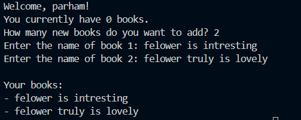

# Personal Book Manager


A simple personal book management program written in Python. It allows users to add books, view their collection, and save book information for future use.

## Project Structure
│   books.py\
│   image-1.png\
│   image.png\
│   main.py\
│   README.md\
│   requairement.txt
## Features

- Add multiple books to your personal collection.
- Display saved books.
- Store book information in a JSON file.
- Load previously saved books when the program runs again.

## Requirements

- Python 3
- python-dotenv

## Installation

Install the required packages using `requirements.txt`:

```bash
pip install -r requirements.txt
```

## Environment Setup

1. Create a file named `.env` in the project directory.
2. Use `.env.example` as a template.
3. Add the following variable to your `.env` file:

```env
BOOK_MANAGER_ADMIN_PASSWORD=your_password_here
```

4. Replace `your_password_here` with your own password.

**Important:** Never upload your actual `.env` file or real password to GitHub. Keep `.env` private and include `.env.example` in your repository.

## Run the Program

The main program file is `main.py`.

Run the program from the project directory:

```bash
python main.py
```

## Screenshot


## how it work
you just give the program what is your book then readet


## Troubleshooting

### 1. FileNotFoundError
- **What does it mean?** The program cannot find the `books.json` file.
- **Why might it happen?** The file may not exist or may be in the wrong location.
- **What do I check first?** I check if `books.json` exists in the correct folder.

### 2. JSONDecodeError
- **What does it mean?** The program cannot read the JSON data.
- **Why might it happen?** The `books.json` file may be empty or corrupted.
- **What do I check first?** I check the contents of `books.json`.

### 3. python-dotenv Not Found
- **What does it mean?** Python cannot find the `python-dotenv` library.
- **Why might it happen?** The library may not be installed.
- **What do I check first?** I check if `python-dotenv` is installed.

### 4. Password Not Loaded from .env
- **What does it mean?** The program cannot read the password from the `.env` file.
- **Why might it happen?** The variable name may be incorrect, or the `.env` file may be in the wrong location.
- **What do I check first?** I check the `ADMIN_CODE` variable name and the location of the `.env` file.
